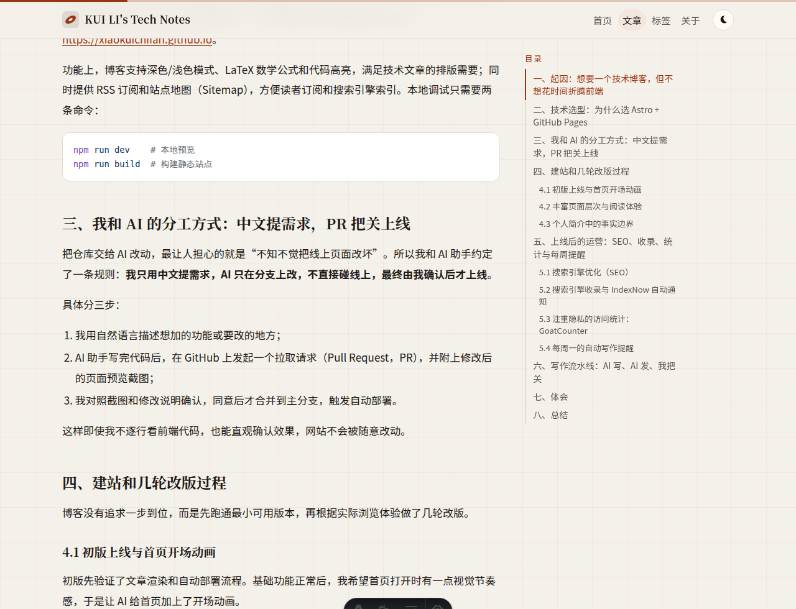

## 一、起因：想要一个技术博客，但不想花时间折腾前端

一直想维护一个属于自己的技术博客，用来沉淀技术笔记、工具实践和项目复盘。但真正准备动手建站时，很多工程师都会在第一步卡住：从选框架、调样式、适配不同屏幕，到折腾构建脚本和部署流程，往往还没开始写第一篇文章，精力就已经耗在了前端细节上。

我希望把时间尽量花在思考和输出内容上，而不是反复排查样式错位或构建报错。于是我决定换一种方式：由我来确定目标、提需求并把关结果，把具体的建站编码、页面迭代和日常运维交给 AI 助手来完成。这篇文章记录的，就是这套博客从搭建到持续运营的完整过程。

## 二、技术选型：为什么选 Astro + GitHub Pages

站点选择了静态站点生成器 [Astro](https://astro.build/) 搭配 [GitHub Pages](https://pages.github.com/)。对于以阅读为主的个人技术博客来说，纯静态站点不需要维护后端服务和数据库，稳定性和加载速度都很省心。

代码托管在 GitHub 仓库 `xiaokuichifan/xiaokuichifan.github.io`，配合 [GitHub Actions](https://github.com/features/actions) 自动构建和部署。每当主分支有新提交，工作流就会自动完成构建并发布到 [https://xiaokuichifan.github.io](https://xiaokuichifan.github.io)。

功能上，博客支持深色/浅色模式、LaTeX 数学公式和代码高亮，满足技术文章的排版需要；同时提供 RSS 订阅和站点地图（Sitemap），方便读者订阅和搜索引擎索引。本地调试只需要两条命令：

```bash
npm run dev    # 本地预览
npm run build  # 构建静态站点
```

## 三、我和 AI 的分工方式：中文提需求，PR 把关上线

把仓库交给 AI 改动，最让人担心的就是“不知不觉把线上页面改坏”。所以我和 AI 助手约定了一条规则：**我只用中文提需求，AI 只在分支上改，不直接碰线上，最终由我确认后才上线**。

具体分三步：

1. 我用自然语言描述想加的功能或要改的地方；
2. AI 助手写完代码后，在 GitHub 上发起一个拉取请求（Pull Request，PR），并附上修改后的页面预览截图；
3. 我对照截图和修改说明确认，同意后才合并到主分支，触发自动部署。

这样即使我不逐行看前端代码，也能直观确认效果，网站不会被随意改动。

## 四、建站和几轮改版过程

博客没有追求一步到位，而是先跑通最小可用版本，再根据实际浏览体验做了几轮改版。

### 4.1 初版上线与首页开场动画

初版先验证了文章渲染和自动部署流程。基础功能正常后，我希望首页打开时有一点视觉节奏感，于是让 AI 给首页加上了开场动画。

### 4.2 丰富页面层次与阅读体验

用了一段时间后，我觉得首页和文章页还是偏单薄，于是又整理了一批改版需求交给 AI：

- **首页名片与文章列表**：增加头像和研究方向卡片，让访客快速了解站点主题；文章卡片补充发布日期、预计阅读时间和标签。
- **长文阅读辅助**：文章页加上目录和阅读进度条，读长篇技术文章时可以随时跳转章节。
- **整体细节**：补齐页脚，并给页面加了一层淡淡的网格背景。




### 4.3 个人简介中的事实边界

生成个人简介时，AI 难免遇到它不了解的背景信息。我明确要求它不能自行脑补或编造经历：凡是无法确定的个人资料，统一用 `【待填写】` 标出，留给我本人核实后再补。这种“宁可留空、绝不瞎编”的原则，在让 AI 写任何和“我”有关的内容时都非常关键。

## 五、上线后的运营：SEO、收录、统计与每周提醒

网站部署成功只是开始。上线之后还要解决搜索引擎可见性、访问统计和更新节奏的问题，避免博客变成“只有自己知道的孤岛”。

### 5.1 搜索引擎优化（SEO）

为了让文章在搜索结果和社交转发时显示规范的标题和摘要，站点加上了基础的 SEO 配置：每个页面独立的标题和描述、社交分享卡片（Open Graph）、结构化数据（JSON-LD）、构建时自动生成的分享图，以及根目录下的爬虫规则文件 `robots.txt`：

```txt
User-agent: *
Allow: /

Sitemap: https://xiaokuichifan.github.io/sitemap-index.xml
```

### 5.2 搜索引擎收录与 IndexNow 自动通知

收录主要围绕 Google 和 Bing。在 [Google Search Console](https://search.google.com/search-console) 里，我用 HTML 文件的方式完成了网站所有权验证，然后提交了站点地图 `sitemap-index.xml`。

刚提交时，后台状态一度显示“无法抓取”。检查后确认站点地图地址能正常打开、内容完整，这是新站刚提交时的常见状态，保持线上可访问、耐心等待即可。

Bing 这边，[Bing 网站管理员工具](https://www.bing.com/webmasters)支持直接从 Google Search Console 导入站点，几步就能完成验证。为了让新文章更快被 Bing 抓取，部署流程里还加了 [IndexNow](https://www.indexnow.org/) 自动通知：网站部署成功后运行一个脚本，把站点地图里的网址提交给 IndexNow。这一步设置了容错，通知失败也不会影响网站上线：

```yaml
- name: Submit sitemap to IndexNow
  if: success()
  continue-on-error: true
  run: node scripts/indexnow.mjs || true
```

### 5.3 注重隐私的访问统计：GoatCounter

访问统计选用了 [GoatCounter](https://www.goatcounter.com/)，主要有三个原因：个人站点免费、不用 Cookie 追踪访客、脚本足够轻量，不会拖慢页面，也不需要弹隐私提示。

### 5.4 每周一的自动写作提醒

很多个人博客建好之后都会慢慢停更。为了保持更新节奏，我让 AI 设置了一个定时任务：**每周一上午 10 点（日本时间）**提醒我写文章，附上几条选题建议，并汇报上周的访问数据。

## 六、写作流水线：AI 写、AI 发、我把关

建站和运营都稳定下来后，我把“写文章到发布”也整理成了一条双 AI 流水线：

1. **本地起草**：用反重力（Antigravity）写文章，稿件放在本地 `D:\2_Personal_Blog` 下的独立文件夹里，正文叫 `index.md`，配图放在同一个文件夹，用相对路径引用。
2. **取稿与开 PR**：另一个负责博客仓库的 AI 助手从这个文件夹取稿，检查格式和事实、整理图片，然后在 GitHub 上开一个 PR。
3. **人工确认发布**：我看过 PR 的预览确认无误后合并，随后自动部署并通知 IndexNow。

你现在读到的这篇文章，就是通过这条流水线写出来、经过 PR 审核后发布的。

## 七、体会

整个过程下来，最直接的感受就是**很方便**：从建站、改版、SEO、收录到统计和定时提醒，我几乎完全不需要自己动手写代码，只要把想法说清楚，再在上线前看一眼、点个头就行。

当然，人仍然要把住几道关：

- **上线前的确认**：所有改动都先走 PR，看过预览再合并；
- **事实的真实性**：涉及个人经历和数据的内容，AI 不确定就留空，由我来补；
- **账号和密码**：注册、登录、验证这些涉及账号安全的步骤，由我自己完成。

把这几道关守住，剩下的重复性工作都可以放心交给 AI。在我看来，AI 正在改变人们的生活方式，也改变了一个人做一件事的方式：以前要自己从头学前端、配部署才能拥有的博客，现在用说话的方式就能搭起来、运营起来。

## 八、总结

回头看，这套方式的核心并不复杂：用 Astro 和 GitHub Pages 做简洁稳定的静态底座，用 PR 预览把控每次改动，用 Search Console、IndexNow 和 GoatCounter 补齐收录和统计，再配合本地起草、AI 发 PR、人工确认的写作流水线，把重复的工程和排版工作降到最低。

如果你也想拥有一个技术博客，又不想长期陷在前端折腾里，可以试试这种方式：把方向、事实和最终合并权留在自己手里，其余的交给 AI。
